# Trabalho 02 – Implementação e Análise de uma VPN com WireGuard

**Universidade Federal do Piauí – UFPI**<br>
Centro de Ciências da Natureza – CCN · Departamento de Computação<br>
Bacharelado em Ciência da Computação

**Disciplina:** Segurança em Sistemas Computacionais<br>
**Professor:** Carlos André Batista de Carvalho<br>
**Grupo 3**, com Gateway da Filial `10.10.10.13` na VPN

**Integrantes:**<br>
MONNIK LUIANNE OLIVEIRA NASCIMENTO VELOSO BARBOSA<br>
FRANCIELIO EVANGELISTA DOS SANTOS CASTRO<br>
LUIDGE DE SOUSA CARVALHO

Teresina – PI, novembro de 2026

## Introdução

Este relatório apresenta a implantação de uma VPN *Gateway-to-Gateway* entre uma Filial, montada pelo grupo com duas máquinas virtuais no VirtualBox, e a Matriz, um servidor central mantido pelo professor, usando o protocolo **WireGuard**. O tráfego foi capturado em dois pontos durante o acesso a um arquivo confidencial da Matriz: na rede interna da Filial e na saída externa do Gateway. Em seguida, foi analisado no Wireshark.

O objetivo é observar na prática o tunelamento na camada de rede, o efeito do encapsulamento sobre o tamanho dos pacotes, a correspondência com o IPsec (ESP em modo túnel) e os limites da proteção oferecida por uma VPN quando a aplicação usa HTTP sem TLS.

O texto segue a ordem das questões do roteiro (Questões 1 a 8). Cada afirmação é comprovada por *prints* das telas e por números de pacotes das capturas, que acompanham o relatório (`captura_interna.pcapng` e `captura_externa.pcapng`).

## Ambiente e topologia

O grupo recebeu o número **N = 3**, portanto o Gateway da Filial usa o endereço `10.10.10.(10+3) = 10.10.10.13` na VPN.

| Equipamento | Interface | Endereço |
|---|---|---|
| Cliente (VM 1, `Filial-Cliente`) | `eth0`: rede interna `rede_filial` | `192.168.100.2/24`, *gateway* padrão `192.168.100.1` |
| Gateway (VM 2, `Filial-Gateway`) | `eth1`: rede interna `rede_filial` | `192.168.100.1/24` |
| | `eth0`: NAT do VirtualBox | `10.0.2.15` |
| | `wg0`: túnel WireGuard | `10.10.10.13/24`, MTU 1420 |
| Matriz (servidor do professor) | *Endpoint* público | `163.176.207.0:51820/UDP` |
| | `wg0` | `10.10.10.1/24`, serviço HTTP na porta 8080 |

```
                Ponto A                    Ponto B
                   |                          |
[Cliente] --- rede_filial --- [Gateway] --- eth0 (NAT do VirtualBox) --- Internet --- [Matriz]
192.168.100.2           eth1 192.168.100.1  10.0.2.15                            163.176.207.0:51820
                          wg0 10.10.10.13 ======= túnel WireGuard ======= wg0 10.10.10.1, HTTP :8080
```

As placas de rede das VMs foram configuradas conforme o roteiro: o Cliente tem um único adaptador em Rede Interna (`rede_filial`) (Figura 1), e o Gateway tem o adaptador 1 em NAT e o adaptador 2 em Rede Interna (`rede_filial`) (Figura 2).

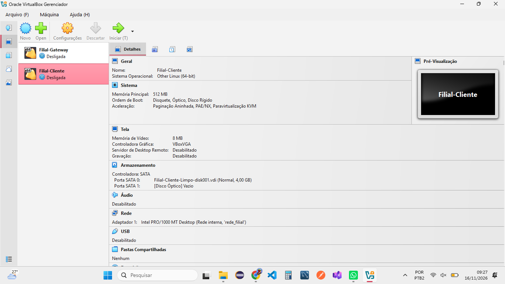

<sub>**Figura 1.** VM `Filial-Cliente`: um único adaptador, em Rede Interna (`rede_filial`).</sub>

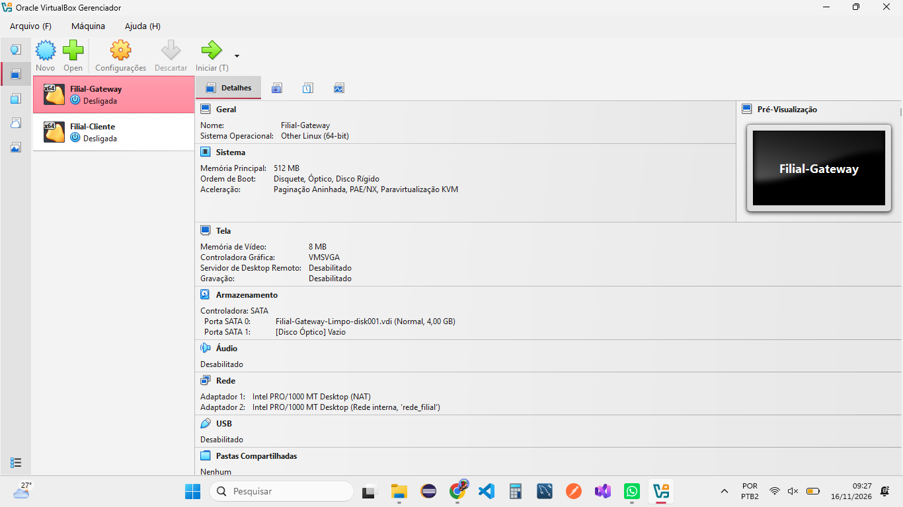

<sub>**Figura 2.** VM `Filial-Gateway`: adaptador 1 em NAT e adaptador 2 em Rede Interna (`rede_filial`).</sub>

Configuração usada no Gateway (`/etc/wireguard/wg0.conf`). A chave privada não aparece no arquivo: ela é carregada de `/etc/wireguard/priv` pelo `PostUp`.

```ini
[Interface]
Address    = 10.10.10.13/24
PostUp     = wg set %i private-key /etc/wireguard/priv
PostUp     = iptables -A FORWARD -i eth1 -o wg0 -j ACCEPT; iptables -A FORWARD -i wg0 -o eth1 -j ACCEPT
PostDown   = iptables -D FORWARD -i eth1 -o wg0 -j ACCEPT; iptables -D FORWARD -i wg0 -o eth1 -j ACCEPT

[Peer]  # hub do professor (Matriz)
PublicKey           = f/iC7Qjn/DWolU6sBpFNFS5GeSrooYaIobJJDh5Llg8=
Endpoint            = 163.176.207.0:51820
AllowedIPs          = 10.10.10.0/24
PersistentKeepalive = 25
```

## Execução do experimento

1. **Preparação das VMs (Etapa 1):** importação das VMs `Filial-Cliente` e `Filial-Gateway` e conferência dos adaptadores de rede. Como as VMs não têm interface gráfica, foram acessadas por SSH a partir do Windows (`ssh -p 2222 aluno@127.0.0.1` para o Gateway e `ssh -J aluno@127.0.0.1:2222 aluno@192.168.100.2` para o Cliente).
2. **Túnel no Gateway (Etapa 2):** geração do par de chaves com `wg genkey` / `wg pubkey`, envio da chave pública ao professor, ajuste do `Address` para `10.10.10.13/24` e ativação com `sudo wg-quick up wg0`. Em seguida foram ativados o encaminhamento (`sysctl -w net.ipv4.ip_forward=1`) e o NAT (`iptables -t nat -A POSTROUTING -o wg0 -j MASQUERADE`). O primeiro handshake só foi concluído depois que o professor cadastrou a chave do grupo na Matriz (Questões 1 e 2).
3. **Testes a partir do Cliente (Etapa 3):** `ping` para o Gateway e para a Matriz, ambos com 0% de perda (Figura 3), e a requisição `curl -v http://10.10.10.1:8080/dados_confidenciais.txt`, que retornou `HTTP/1.0 200 OK` com o conteúdo do arquivo (Figura 4).
4. **Capturas (Etapa 4):** durante o `curl`, o tráfego foi gravado simultaneamente nos dois pontos pelo próprio VirtualBox (`VBoxManage controlvm <VM> nictrace1 on`). O **Ponto A** é a placa do Cliente, na `rede_filial`. O **Ponto B** é a placa `eth0` do Gateway, na saída para a Internet. Os arquivos `.pcap` gerados foram convertidos para `captura_interna.pcapng` e `captura_externa.pcapng` no Wireshark.

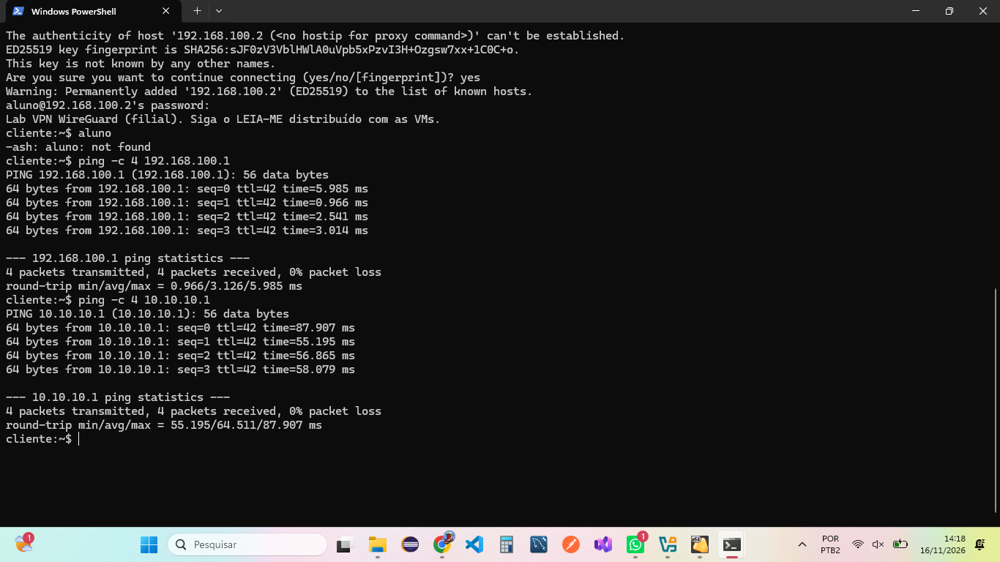

<sub>**Figura 3.** Testes de conectividade a partir do Cliente: `ping` para o Gateway (`192.168.100.1`) e para a Matriz (`10.10.10.1`).</sub>

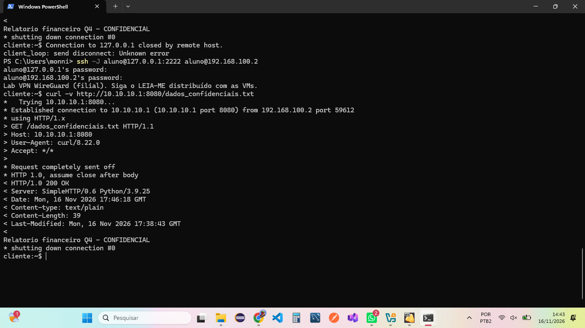

<sub>**Figura 4.** Requisição `curl -v` ao arquivo confidencial da Matriz, com resposta `200 OK` e o conteúdo do arquivo.</sub>

> **Sobre os horários das capturas:** a gravação do VirtualBox conta o tempo a partir da inicialização de cada VM. Por isso o Wireshark mostra datas de 1969/1970, e as duas capturas têm uma diferença constante de 17100,16 s entre si (Questão 4). A requisição analisada ocorreu em 16/11/2026, às 17:46:18 GMT, conforme o cabeçalho `Date:` da resposta HTTP.

O passo a passo completo de comandos está em `config/comandos_executados.md`.

> **Sobre os prints:** os prints do Wireshark das Questões 1 a 5 foram feitos na interface gráfica, no Windows. Os das Questões 6 a 8 foram gerados depois, sobre as mesmas capturas, com o **tshark 4.6.9**, a versão de linha de comando do Wireshark, que usa os mesmos dissecadores. Cada print mostra o comando executado e a sua saída, para que o resultado possa ser reproduzido.

## Questão 1 – Estabelecimento da conexão VPN no WireGuard

Ao executar `sudo wg-quick up wg0`, o utilitário `wg-quick` lê o arquivo `/etc/wireguard/wg0.conf` e executa, em sequência, os passos registrados na saída do comando (Figura 5):

1. cria a interface virtual `wg0` do tipo `wireguard`;
2. aplica a configuração do peer (`wg addconf`);
3. atribui o endereço do túnel `10.10.10.13/24` (grupo N = 3);
4. ajusta o MTU da interface para **1420 bytes** e a ativa (o valor é menor que os 1500 bytes da Ethernet para acomodar os cabeçalhos extras do encapsulamento);
5. carrega a chave privada a partir de `/etc/wireguard/priv` (`PostUp = wg set %i private-key ...`), sem que ela fique escrita no arquivo de configuração;
6. executa as demais instruções `PostUp` (regras de `iptables`, discutidas na Questão 2).

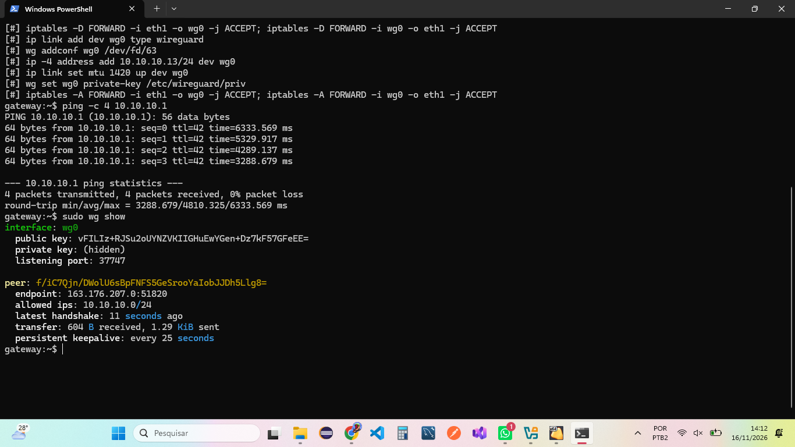

<sub>**Figura 5.** Saída do `wg-quick up wg0` (interface, endereço `10.10.10.13/24`, MTU 1420, chave privada e regras `PostUp`) e `wg show` com o handshake concluído.</sub>

A sessão criptográfica em si só é estabelecida quando há tráfego a enviar ao peer (ou um keepalive): nesse momento o Gateway envia uma mensagem *Handshake Initiation* e a Matriz responde com *Handshake Response*. Na captura externa, essas mensagens aparecem com 190 e 134 bytes, respectivamente (Figura 6).

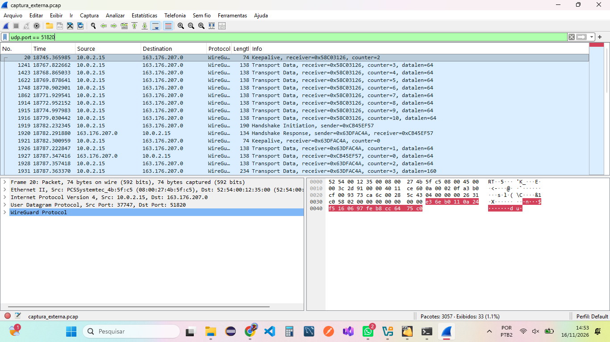

<sub>**Figura 6.** Captura externa com o filtro `udp.port == 51820`: tráfego WireGuard entre `10.0.2.15` e `163.176.207.0`.</sub>

### a) Autenticação: chaves simétricas ou assimétricas?

A autenticação é baseada em **chaves assimétricas**. Cada lado possui um par de chaves estáticas Curve25519. No laboratório, o par do Gateway foi gerado com `wg genkey` / `wg pubkey` (Figura 7); a chave pública foi entregue ao professor, e a chave pública da Matriz já constava na seção `[Peer]` do `wg0.conf`.

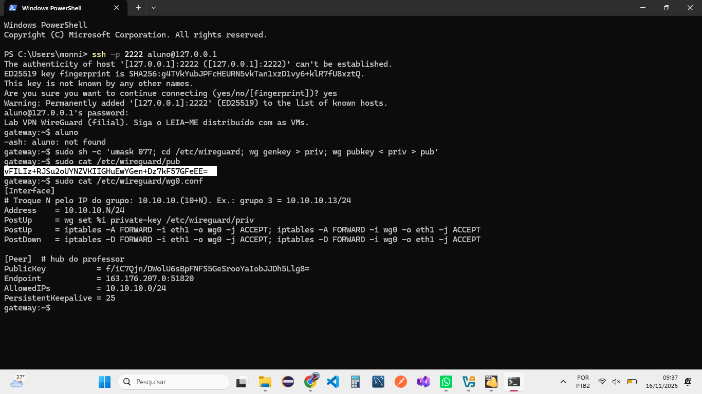

<sub>**Figura 7.** Geração do par de chaves do Gateway com `wg genkey` / `wg pubkey` e o `wg0.conf` fornecido com as VMs.</sub>

**Ambas as partes são autenticadas (autenticação mútua).** O handshake segue o padrão `Noise_IKpsk2` do Noise Protocol Framework: o iniciador já conhece a chave pública estática do respondedor e envia a sua própria chave pública cifrada. As chaves de sessão são derivadas da combinação de várias trocas Diffie-Hellman (efêmera–estática, estática–estática e efêmera–efêmera), de modo que só quem possui as chaves privadas correspondentes consegue concluir o handshake. Depois disso, o tráfego é cifrado com **chaves simétricas de sessão** derivadas dessas trocas. O protocolo ainda permite uma chave pré-compartilhada simétrica opcional (`PresharedKey`), que não foi usada neste laboratório.

O próprio experimento evidencia a autenticação: antes de o professor cadastrar a chave pública do grupo, o `wg show` exibia `0 B received` e nenhuma linha `latest handshake` (Figura 8). A Matriz descartava silenciosamente as tentativas de handshake de uma chave desconhecida, sem enviar resposta. Após o cadastro, o handshake foi concluído (`latest handshake: 11 seconds ago`, `604 B received`) (Figura 5).

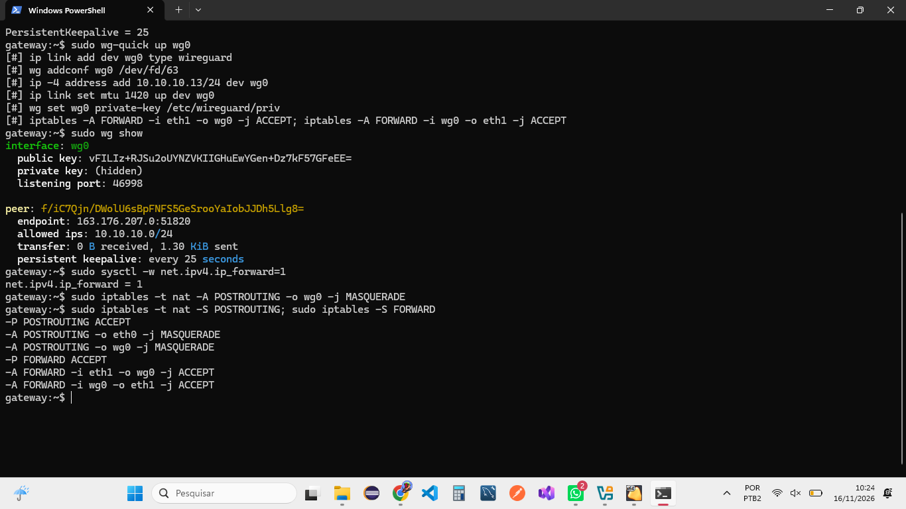

<sub>**Figura 8.** Túnel ativo antes do cadastro da chave na Matriz (`0 B received`, sem handshake), ativação do IP forwarding e do `MASQUERADE` e regras do iptables em vigor.</sub>

### b) Funções e algoritmos criptográficos

| Função | Algoritmo |
|---|---|
| Troca de chaves (Diffie-Hellman) | **Curve25519** (X25519) |
| Confidencialidade e integridade (cifra autenticada AEAD) | **ChaCha20-Poly1305** |
| Hash, MAC e derivação de chaves (HKDF) | **BLAKE2s** |
| Chaveamento de tabelas internas | SipHash24 |
| Proteção contra negação de serviço (cookies) | XChaCha20-Poly1305 |
| Estrutura do handshake | Noise Protocol Framework (`Noise_IKpsk2`) |

**Não existe negociação de algoritmos.** O conjunto criptográfico é fixo e definido pela versão do protocolo; se algum algoritmo for considerado inseguro no futuro, a solução é publicar uma nova versão do protocolo.

**Vantagens frente à flexibilidade do IPsec.** No IPsec, o IKE negocia algoritmos de cifra, integridade, grupos DH e parâmetros das SAs, o que oferece flexibilidade (por exemplo, para atender a requisitos de conformidade), mas aumenta a complexidade. A abordagem do WireGuard:

- reduz drasticamente o código (cerca de 4 mil linhas, contra centenas de milhares em implementações IPsec), diminuindo a superfície de ataque e facilitando auditoria e verificação formal;
- elimina ataques de *downgrade*, em que um atacante força a escolha de um algoritmo mais fraco durante a negociação;
- evita erros de configuração, já que não há combinações de algoritmos inseguras para escolher;
- torna o handshake menor e mais rápido (1 ida e volta).

A desvantagem é a perda de agilidade criptográfica: não é possível trocar um algoritmo sem atualizar todo o protocolo.

### c) PersistentKeepalive

**Finalidade.** `PersistentKeepalive = 25` faz o Gateway enviar ao peer um pacote autenticado vazio sempre que ficar 25 segundos sem enviar tráfego. Como o WireGuard é silencioso por padrão (só transmite quando há dados), sem o keepalive as entradas das tabelas de NAT e de firewall com estado entre a Filial e a Matriz expirariam. No laboratório, o Gateway está atrás de dois NATs (o NAT do VirtualBox, que lhe atribui o endereço `10.0.2.15`, e o NAT da rede local). Sem o keepalive, a Matriz não conseguiria iniciar comunicação com a Filial após um período de inatividade. Por isso a opção é configurada no lado que está atrás do NAT.

**Impacto visual na captura externa.** Os keepalives aparecem no Wireshark como `Keepalive` do protocolo WireGuard, com **74 bytes** cada:

| Camada | Bytes |
|---|---|
| Ethernet | 14 |
| IPv4 | 20 |
| UDP | 8 |
| Cabeçalho WireGuard (tipo, índice do receptor, contador) | 16 |
| Tag de autenticação Poly1305 (payload vazio) | 16 |
| **Total** | **74** |

O campo `counter` aumenta a cada pacote (é o *nonce* da cifra e também protege contra replay).

**Alteração do parâmetro.** O valor foi alterado em tempo de execução com `sudo wg set wg0 peer <chave_matriz> persistent-keepalive 5` (Figura 9) e a saída do Gateway foi gravada por cerca de 1 minuto e meio em cada configuração:

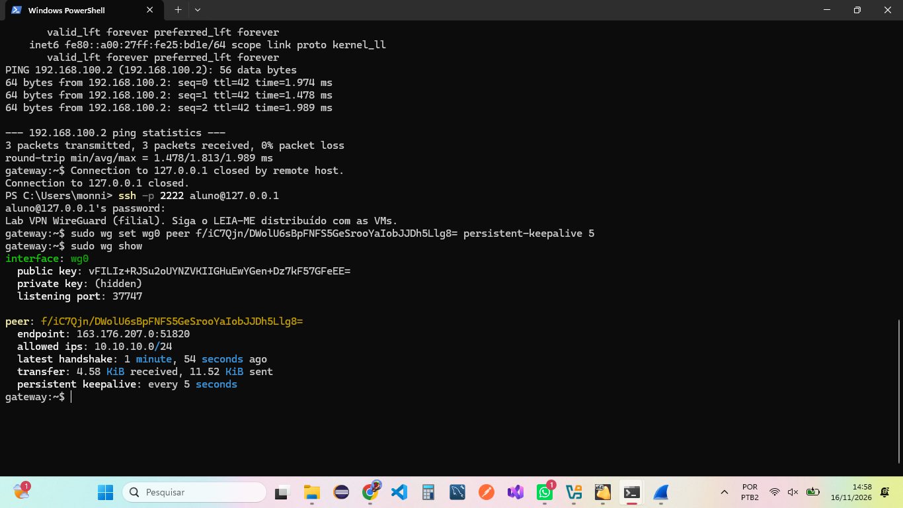

<sub>**Figura 9.** Alteração do `PersistentKeepalive` para 5 s em tempo de execução (`wg set ... persistent-keepalive 5`).</sub>

| Configuração | Intervalo observado | Tamanho | Observação |
|---|---|---|---|
| 25 s | ~23 s entre keepalives | 74 bytes | 6 keepalives em ~93 s (Figura 10) |
| 5 s | ~4,7 s entre keepalives | 74 bytes | 22 keepalives em ~94 s (contra 6 na captura de 25 s) (Figura 11) |

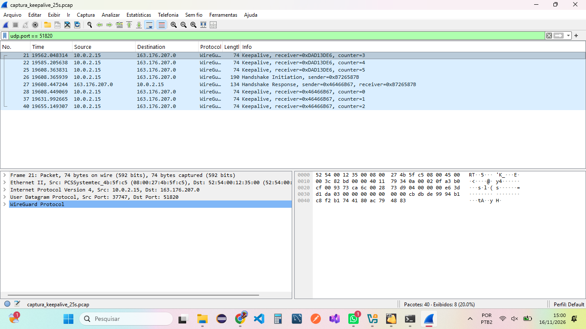

<sub>**Figura 10.** Captura com `PersistentKeepalive = 25`: keepalives de 74 bytes a cada ~23 s e um handshake de renovação de chaves.</sub>

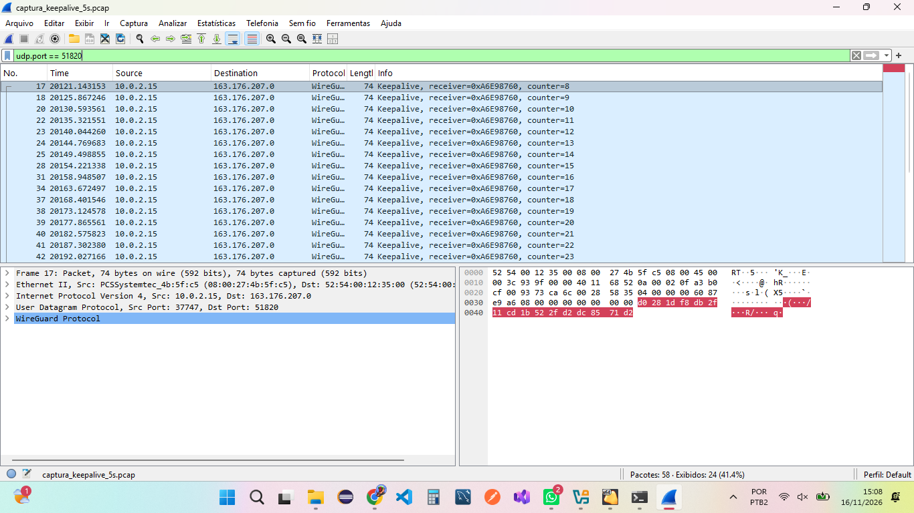

<sub>**Figura 11.** Captura com `PersistentKeepalive = 5`: keepalives de 74 bytes a cada ~4,7 s, com o `counter` crescente.</sub>

O tamanho do pacote não muda; apenas a frequência aumenta, cerca de cinco vezes (22 keepalives contra 6 em um intervalo de ~94 s). Os intervalos medidos ficaram um pouco abaixo dos configurados (~23,2 s e ~4,7 s), diferença que provavelmente se deve à forma como o VirtualBox registra o tempo dos pacotes na gravação. Nas duas capturas também aparece um par *Handshake Initiation/Response* (190/134 bytes), resultado da renovação periódica das chaves de sessão, que o WireGuard faz a cada 2 minutos.

**Conclusão.** Um intervalo menor mantém o mapeamento de NAT com mais folga, mas gera mais tráfego de controle, o que importa em links tarifados e dispositivos móveis. O valor padrão de 25 s é um bom equilíbrio, já que a maioria dos NATs mantém mapeamentos UDP por pelo menos 30 s. Ao final do experimento, o valor foi restaurado para 25 s.

## Questão 2 – Uso do iptables no ambiente

O `iptables` é a interface de configuração do Netfilter, o firewall do kernel Linux. No Gateway da Filial, ele foi usado para dois fins: **permitir o encaminhamento** de pacotes entre a rede interna e o túnel e **traduzir endereços (NAT)** do tráfego que entra no túnel. As regras ativas foram listadas com `sudo iptables -t nat -S POSTROUTING; sudo iptables -S FORWARD` (Figura 8):

```
-P POSTROUTING ACCEPT
-A POSTROUTING -o eth0 -j MASQUERADE
-A POSTROUTING -o wg0 -j MASQUERADE
-P FORWARD ACCEPT
-A FORWARD -i eth1 -o wg0 -j ACCEPT
-A FORWARD -i wg0 -o eth1 -j ACCEPT
```

### Pré-requisito: IP forwarding

`sudo sysctl -w net.ipv4.ip_forward=1` não é uma regra de iptables, mas é o que permite ao Linux atuar como roteador. Sem ele, os pacotes do Cliente que chegam pela `eth1` com destino à Matriz seriam descartados, em vez de encaminhados para a `wg0`.

### Regras especificadas no `wg0.conf` (tabela `filter`, cadeia `FORWARD`)

```ini
PostUp   = iptables -A FORWARD -i eth1 -o wg0 -j ACCEPT; iptables -A FORWARD -i wg0 -o eth1 -j ACCEPT
PostDown = iptables -D FORWARD -i eth1 -o wg0 -j ACCEPT; iptables -D FORWARD -i wg0 -o eth1 -j ACCEPT
```
(Figura 12)

- **`-A FORWARD -i eth1 -o wg0 -j ACCEPT`**: aceita o encaminhamento dos pacotes que chegam da rede interna da Filial (`eth1`, 192.168.100.0/24) e saem pelo túnel (`wg0`). É o caminho da requisição do Cliente até a Matriz.
- **`-A FORWARD -i wg0 -o eth1 -j ACCEPT`**: aceita o caminho inverso, ou seja, as respostas da Matriz que chegam pelo túnel com destino ao Cliente.
- **`PostUp` / `PostDown`**: o `wg-quick` adiciona essas regras quando o túnel sobe e as remove (`-D`) quando ele desce, de modo que só existem enquanto a VPN está ativa. Isso pode ser observado na saída do `wg-quick up` e do `wg-quick down` (Figura 5).

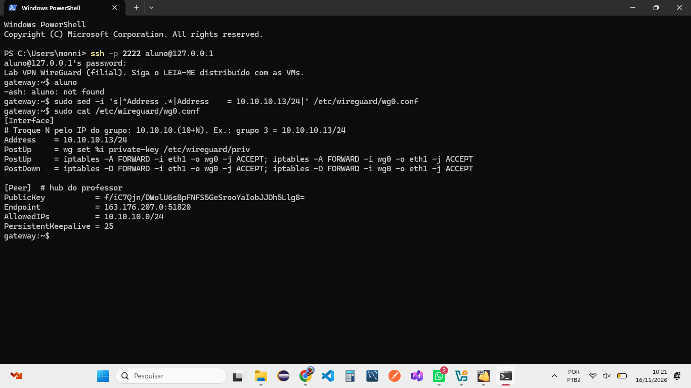

<sub>**Figura 12.** `wg0.conf` ajustado com o IP do grupo (`10.10.10.13/24`) e as regras `PostUp` / `PostDown`.</sub>

**Observação:** a política padrão da cadeia `FORWARD` nesta VM é `ACCEPT` (`-P FORWARD ACCEPT`), então essas regras são redundantes no ambiente atual, pois tudo já seria encaminhado. Elas passariam a ser determinantes num cenário endurecido, com política `-P FORWARD DROP`. Nesse caso, apenas o tráfego entre a LAN e o túnel seria permitido, idealmente combinado com uma regra de estado (`-m conntrack --ctstate ESTABLISHED,RELATED`) para restringir o sentido Matriz→Filial a respostas de conexões iniciadas pela Filial.

### Regras de NAT (tabela `nat`, cadeia `POSTROUTING`)

- **`-A POSTROUTING -o wg0 -j MASQUERADE`** (configurada manualmente, conforme a Etapa 2 do roteiro): faz a tradução de endereço de origem (SNAT) dos pacotes que saem pelo túnel. O endereço do Cliente, `192.168.100.2`, é substituído pelo endereço do Gateway na VPN, `10.10.10.13`. Essa regra é necessária por três motivos:
  1. **Roteamento por chave criptográfica:** na Matriz, o peer do grupo 3 só é aceito com o endereço `10.10.10.13`. Um pacote com origem `192.168.100.2` seria descartado.
  2. **Rota de retorno:** a Matriz não conhece a rede `192.168.100.0/24` e não saberia para onde enviar as respostas.
  3. **Sobreposição de redes:** como todos os grupos usam a mesma rede interna `192.168.100.0/24`, o NAT faz com que a Matriz enxergue cada filial apenas pelo seu IP único na VPN.

  Na captura interna, os pacotes da requisição ainda têm origem `192.168.100.2` (Figura 13), o que mostra que a tradução acontece no Gateway, antes da cifragem.

  Por ter sido inserida manualmente, essa regra se perde quando o Gateway reinicia. Para torná-la permanente, ela pode ser incluída no `wg0.conf` como `PostUp = iptables -t nat -A POSTROUTING -o wg0 -j MASQUERADE` e `PostDown = iptables -t nat -D POSTROUTING -o wg0 -j MASQUERADE`.

- **`-A POSTROUTING -o eth0 -j MASQUERADE`** (já presente na VM): mascara os pacotes encaminhados que saem pela interface externa `eth0`. Ela permitiria, por exemplo, que o Cliente acessasse a Internet através do Gateway. Ela não participa do tráfego da VPN: os datagramas UDP do WireGuard são gerados pelo próprio Gateway, já com o endereço da `eth0` (`10.0.2.15`).

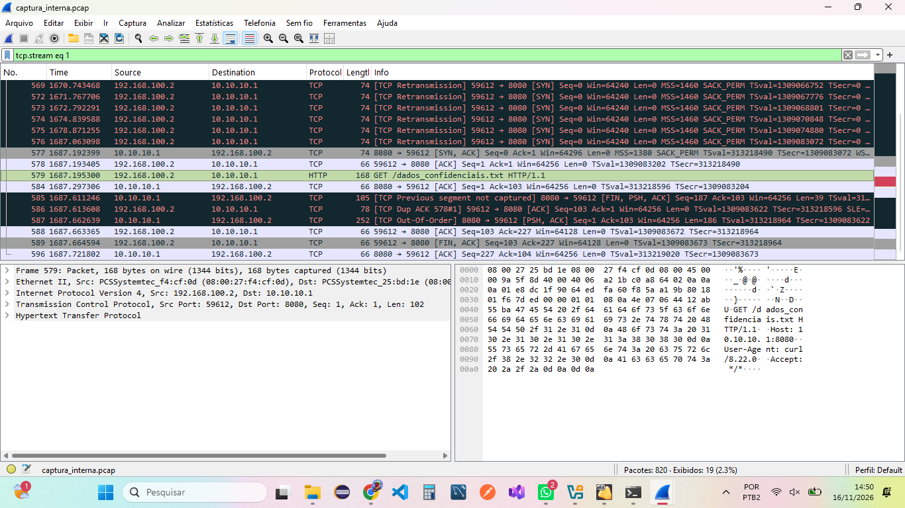

<sub>**Figura 13.** Captura interna com `tcp.stream eq 1`: pacotes do `curl` entre `192.168.100.2` e `10.10.10.1` (SYN com MSS 1460, SYN-ACK com MSS 1380, GET de 168 bytes).</sub>

### Configurações relacionadas no `wg0.conf`

- **`AllowedIPs = 10.10.10.0/24`**: define quais destinos são enviados pelo túnel (o `wg-quick` cria a rota correspondente para a `wg0`) e quais origens são aceitas vindas do peer. Como apenas a rede da VPN está listada, só o tráfego destinado à Matriz passa pelo túnel; o restante segue pela rota normal. Isso é o chamado *split tunneling*.
- **`PostUp = wg set %i private-key /etc/wireguard/priv`**: não é uma regra de firewall, mas segue o mesmo mecanismo de *hooks* do `wg-quick`, carregando a chave privada sem deixá-la exposta no arquivo de configuração.

## Questão 3 – Análise da rede interna (texto claro)

A captura `captura_interna.pcapng` foi gravada na placa de rede do Cliente (Ponto A, `rede_filial`). Os pacotes do `curl` foram isolados no Wireshark com o filtro `tcp.stream eq 1` (equivalente a `tcp.port == 8080`), que exibe 19 pacotes (Figura 13).

### a) Endereços IP de origem e destino

| Sentido | Origem | Destino | Portas |
|---|---|---|---|
| Requisição (Cliente → Matriz) | `192.168.100.2` | `10.10.10.1` | 59612 → 8080 |
| Resposta (Matriz → Cliente) | `10.10.10.1` | `192.168.100.2` | 8080 → 59612 |

São os **endereços originais** da comunicação: o IP privado do Cliente da Filial e o IP do servidor da Matriz dentro da VPN. Nenhum endereço do túnel (`10.10.10.13`) ou da rede externa aparece aqui, porque o pacote ainda não passou pelo Gateway. A tradução de `192.168.100.2` para `10.10.10.13` (regra `MASQUERADE` na `wg0`, Questão 2) e a cifragem só acontecem quando o pacote sai pela `wg0`. O Gateway é usado apenas como próximo salto: o endereço MAC de destino é o da `eth1` do Gateway (`08:00:27:25:bd:1e`). Também é por isso que as respostas chegam com TTL 63, e não 64: elas passaram por um roteador, o Gateway.

A conexão TCP segue o fluxo normal: *three-way handshake* (pacotes 576–578), `GET` (579), resposta (585 e 587) e encerramento com `FIN` (589 e 596).

> **Observação:** antes do `SYN, ACK` (pacote 577), o Cliente enviou o `SYN` 9 vezes (1 original e 8 retransmissões) ao longo de cerca de 20 s (pacotes 380 a 576). A captura externa explica o motivo: os `SYN` foram cifrados e enviados à Matriz, mas não houve resposta até o WireGuard renegociar a sessão (ver Questão 4).

### b) O que foi possível ler do HTTP

Com **botão direito no pacote `GET` → Seguir → Fluxo TCP**, toda a conversa aparece em texto claro (Figura 14):

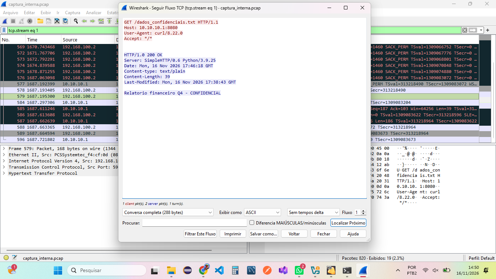

<sub>**Figura 14.** *Seguir Fluxo TCP* na captura interna: requisição e resposta HTTP em texto claro, inclusive o conteúdo do arquivo confidencial.</sub>

**Requisição (pacote 579, 168 bytes):**
```
GET /dados_confidenciais.txt HTTP/1.1
Host: 10.10.10.1:8080
User-Agent: curl/8.22.0
Accept: */*
```

**Resposta (pacotes 587 e 585):**
```
HTTP/1.0 200 OK
Server: SimpleHTTP/0.6 Python/3.9.25
Date: Mon, 16 Nov 2026 17:46:18 GMT
Content-type: text/plain
Content-Length: 39
Last-Modified: Mon, 16 Nov 2026 17:38:43 GMT

Relatorio financeiro Q4 - CONFIDENCIAL
```

Na rede interna é possível ler **tudo**:

- o recurso solicitado (`/dados_confidenciais.txt`), o servidor e a porta (`Host`) e o cliente usado (`curl/8.22.0`);
- o código de status e os metadados da resposta, inclusive o software e a versão do servidor (`SimpleHTTP/0.6 Python/3.9.25`), informação útil para um atacante procurar vulnerabilidades conhecidas;
- o **conteúdo integral do arquivo confidencial**: `Relatorio financeiro Q4 - CONFIDENCIAL`.

Isso acontece porque a aplicação usa HTTP puro, sem TLS. A VPN protege apenas o trecho entre os dois gateways. Na rede interna da Filial, antes de o pacote chegar ao Gateway, ele trafega sem nenhuma proteção (ver Questão 7).

**Por que a resposta aparece fora de ordem.** Na lista de pacotes, o corpo do arquivo (pacote 585, `Seq=187`, com `FIN`) chega **antes** dos cabeçalhos HTTP (pacote 587, `Seq=1`). O Wireshark marca o primeiro como `[TCP Previous segment not captured]` e o segundo como `[TCP Out-Of-Order]`. Esse comportamento não vem da gravação do VirtualBox: houve **perda de pacotes** entre a Matriz e a Filial, seguida de retransmissão pelo TCP:

1. Na captura externa, os contadores WireGuard dos pacotes enviados pela Matriz pulam de 1 para 4 (pacotes 1932 e 1933). Os pacotes com `counter=2` e `counter=3`, que levavam a resposta original (cabeçalhos e corpo), nunca chegaram ao Gateway.
2. O servidor retransmitiu primeiro o **último** segmento (o corpo com `FIN`), comportamento típico do *Tail Loss Probe* do TCP no Linux.
3. O Cliente respondeu com um ACK duplicado contendo **SACK** (pacote 586, 78 bytes, `SLE=187 SRE=227`), informando que recebeu o trecho final mas não o início.
4. O servidor então retransmitiu os cabeçalhos (pacote 587). O TCP do Cliente remontou o fluxo na ordem correta, e por isso o *Seguir Fluxo TCP* exibe a resposta completa e ordenada.

## Questão 4 – Análise da rede externa (encapsulamento e cifra)

A captura `captura_externa.pcapng` foi gravada na placa `eth0` do Gateway (Ponto B), simultaneamente à interna. Ela contém 3057 pacotes, a maioria da sessão SSH usada para administrar a VM (`10.0.2.2` ↔ `10.0.2.15`, porta 22). O tráfego da VPN foi isolado com o filtro `udp.port == 51820`, que exibe 33 pacotes (Figura 6).

Para localizar o mesmo instante da requisição, as duas capturas foram alinhadas pelo primeiro `SYN`: interna em 1667,664 s e externa em 18767,823 s, uma diferença constante de 17100,16 s. Assim, o `GET` (interno 579, 1687,195 s) corresponde ao pacote externo **1931** (18787,363 s).

### a) Endereços IP de origem e destino

| Sentido | Origem | Destino |
|---|---|---|
| Gateway da Filial → Matriz | `10.0.2.15` | `163.176.207.0` |
| Matriz → Gateway da Filial | `163.176.207.0` | `10.0.2.15` |

- `10.0.2.15` é o endereço da `eth0` do Gateway, atribuído pelo NAT do VirtualBox. Na Internet, a Matriz não vê esse endereço privado, e sim o IP público da rede onde o computador hospedeiro está, depois da tradução feita pelo VirtualBox e pelo roteador local.
- `163.176.207.0` é o `Endpoint` da Matriz configurado no `wg0.conf`.

Todos os pacotes da requisição, da resposta e de controle (keepalive e handshake) usam o **mesmo par de endereços**, os dos dois extremos do túnel.

### b) Protocolo de transporte e porta

- Protocolo de transporte: **UDP** (campo `Protocol = 17` do cabeçalho IP).
- Porta de destino: **51820/UDP** na Matriz, a porta padrão do WireGuard e a configurada no `Endpoint`.
- Porta de origem no Gateway: **37747/UDP**, escolhida aleatoriamente pelo WireGuard (o `wg0.conf` usado não define `ListenPort`).

O Wireshark reconhece o conteúdo como **WireGuard Protocol** e mostra apenas o tipo de mensagem (`Handshake Initiation`, `Handshake Response`, `Transport Data`, `Keepalive`), o índice do receptor (`receiver`), o contador e o tamanho do bloco cifrado. Mesmo a conexão interna sendo TCP, não há nenhum cabeçalho TCP visível na rede externa. Todo o segmento TCP vai dentro da carga cifrada do UDP.

### c) É possível localizar a URL, o cabeçalho HTTP ou os dados do arquivo?

**Não.** No pacote 1931 (234 bytes), que transporta o `GET`, o Wireshark mostra apenas `Transport Data, receiver=0x63DFAC4A, counter=3, datalen=160`. Os bytes depois do cabeçalho WireGuard não têm nenhum texto legível. Buscar por `dados_confidenciais`, `GET`, `HTTP` ou `CONFIDENCIAL` (Editar → Localizar pacote → String, em "Bytes do pacote") nos pacotes UDP 51820 não encontra nenhum resultado. O mesmo vale para os pacotes 1933 e 1935, que trazem a resposta.

Isso é o **tunelamento**: o Gateway recebe o datagrama IP completo do Cliente (cabeçalho IP + TCP + HTTP), cifra esse datagrama inteiro com ChaCha20-Poly1305 usando a chave de sessão e o coloca como carga útil de um novo datagrama UDP/IP, endereçado ao outro extremo do túnel. Na rede pública trafega apenas o pacote "externo". O pacote original fica opaco e só é recuperado na Matriz, que tem a chave para decifrá-lo. A tag Poly1305 também garante que qualquer alteração na carga seja detectada e o pacote descartado.

### d) É possível localizar os endereços IP originais?

**Não.** Os endereços `192.168.100.2` (Cliente) e `10.10.10.1` (servidor da Matriz), assim como o `10.10.10.13` gerado pelo `MASQUERADE`, não aparecem em nenhum campo visível. Eles estão no cabeçalho IP **interno**, que foi cifrado junto com o restante do pacote. O filtro `ip.addr == 192.168.100.2 || ip.addr == 10.10.10.1` não retorna nenhum pacote na captura externa. O observador vê apenas os endereços dos gateways (`10.0.2.15` ↔ `163.176.207.0`), ou seja, sabe **que** a Filial conversa com a Matriz, mas não **quais** máquinas conversam nem sobre o quê.

### Observação: renegociação da sessão durante a requisição

A captura externa também explica as retransmissões do `SYN` vistas na Questão 3:

| Pacotes | Tempo | O que aconteceu |
|---|---|---|
| 1241 a 1916 | 18767,8 – 18779,0 s | Os `SYN` do Cliente saem cifrados (138 bytes, `receiver=0x58C03126`, contadores 3 a 10), mas a Matriz não responde nenhum |
| 1919 / 1920 | 18782,2 s | Cerca de 15 s depois do primeiro pacote sem resposta, o Gateway inicia um novo handshake (`Handshake Initiation`, 190 bytes), e a Matriz responde (`Handshake Response`, 134 bytes) |
| 1921 | 18782,3 s | Keepalive que confirma a nova sessão (`receiver=0x63DFAC4A`, `counter=0`) |
| 1926 / 1927 | 18787,2 s | O próximo `SYN` vai na nova sessão e recebe o `SYN, ACK` |

O WireGuard tem uma regra para isso: se enviou dados e não recebeu nada do peer em 15 s (10 s de *keepalive timeout* + 5 s de *rekey timeout*), ele considera a sessão possivelmente perdida e refaz o handshake. A Matriz provavelmente não reconhecia mais a sessão antiga (por exemplo, por ter sido reiniciada ou reconfigurada pelo monitor) e descartava os pacotes em silêncio. A troca do índice de sessão (`0x58C03126` → `0x63DFAC4A`) e o reinício dos contadores em 0 confirmam que uma nova sessão foi criada, com novas chaves.

## Questão 5 – Tamanho dos pacotes e overhead do encapsulamento

O pacote do `GET` foi comparado nas duas capturas (correspondência de tempo explicada na Questão 4):

| | Captura interna (pacote 579) | Captura externa (pacote 1931) |
|---|---|---|
| Quadro no fio (Ethernet) | **168 bytes** | **234 bytes** |
| Datagrama IP | 154 bytes | 220 bytes |
| Datagrama UDP (cabeçalho + carga) | não há UDP | **200 bytes** |
| Exibido pelo Wireshark | `HTTP GET /dados_confidenciais.txt` | `Transport Data, counter=3, datalen=160` |

Prints: pacote interno 579 com 168 bytes (Figura 13) e pacote externo 1931 com 234 bytes, com o campo `Encrypted Packet` de 176 bytes selecionado (Figura 15).

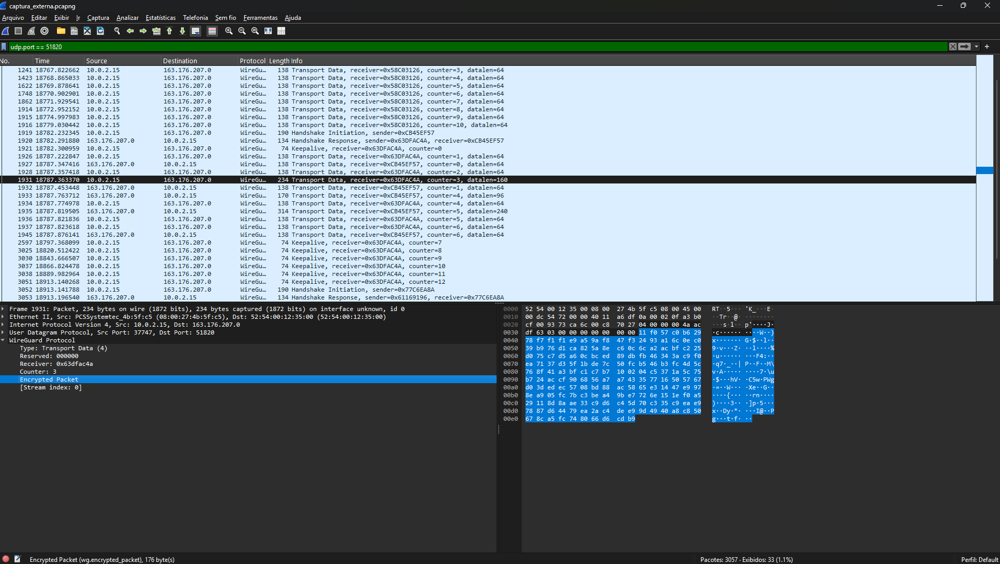

<sub>**Figura 15.** Pacote externo 1931 (234 bytes), que transporta o `GET`: o Wireshark mostra apenas o cabeçalho WireGuard e o `Encrypted Packet` de 176 bytes.</sub>

O mesmo pedido HTTP ocupa **66 bytes a mais** na rede externa: um aumento de cerca de 39% nesse pacote pequeno.

### a) Diferenciar keepalives dos pacotes do curl

**Sim.** Os pacotes de manutenção do túnel têm uma "assinatura" fixa e fácil de reconhecer:

| Tipo | Tamanho do quadro | Como aparece |
|---|---|---|
| Keepalive | **74 bytes** (sempre) | `Keepalive`, carga cifrada vazia (só a tag de 16 bytes) |
| Handshake Initiation / Response | 190 / 134 bytes | Renovação ou recriação da sessão |
| Dados do `curl` | **138 a 314 bytes** | `Transport Data` com `datalen` > 0 |

Na captura externa, os keepalives periódicos (pacotes 20, 2597, 3025, 3030, 3037, 3038, 3051, 3055) aparecem isolados, a intervalos regulares de cerca de 23–25 s, sempre com 74 bytes. Os keepalives 1921 e 3054, também com 74 bytes, são enviados logo depois de cada handshake para confirmar a nova sessão. Os pacotes do `curl` aparecem em rajada: 11 pacotes `Transport Data` entre 18787,22 s e 18787,88 s (pacotes 1926 a 1945), justamente o instante do `curl` na captura interna (Figura 16). O filtro `udp.port == 51820 && frame.len > 74` esconde todos os keepalives e deixa só os handshakes e o tráfego de dados.

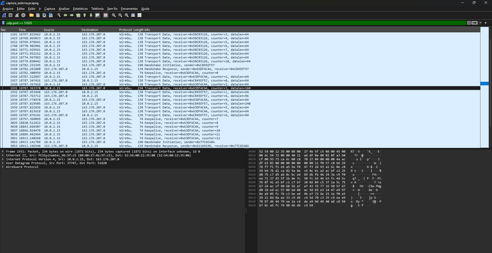

<sub>**Figura 16.** Tráfego WireGuard na captura externa: rajada de `Transport Data` do `curl` (1926–1945) entre keepalives de 74 bytes e handshakes de renovação.</sub>

Também se nota que, enquanto há tráfego, não é preciso enviar keepalive persistente. Depois do último pacote recebido da Matriz (1945), o Gateway envia um keepalive cerca de 9,5 s depois (2597). É o keepalive "passivo" do WireGuard, que confirma o recebimento quando não há dados para enviar em ~10 s. Depois disso, o ciclo de 25 s do `PersistentKeepalive` volta a valer.

O que **não** dá para saber pela captura externa é o conteúdo: identifica-se que houve uma troca de dados naquele instante, e com quais tamanhos, mas não que era um HTTP `GET` nem qual arquivo foi pedido. A identificação exata, pacote a pacote, só foi possível porque havia a captura interna para comparar:

| Pacote do curl | Interno (nº / bytes) | Externo (nº / bytes) |
|---|---|---|
| `SYN` (9ª tentativa) | 576 / 74 | 1926 / 138 |
| `SYN, ACK` | 577 / 74 | 1927 / 138 |
| `ACK` | 578 / 66 | 1928 / 138 |
| **`GET`** | **579 / 168** | **1931 / 234** |
| `ACK` do servidor | 584 / 66 | 1932 / 138 |
| Corpo do arquivo + `FIN` | 585 / 105 | 1933 / 170 |
| `ACK` com SACK | 586 / 78 | 1934 / 138 |
| Cabeçalhos HTTP da resposta | 587 / 252 | 1935 / 314 |
| `ACK` | 588 / 66 | 1936 / 138 |
| `FIN, ACK` | 589 / 66 | 1937 / 138 |
| `ACK` final | 596 / 66 | 1945 / 138 |

### b) A que se deve a diferença de bytes?

A diferença vem do **encapsulamento**. O WireGuard trabalha na camada 3: o Gateway recebe o datagrama IP do Cliente (154 bytes; o cabeçalho Ethernet interno não é transportado), cifra esse datagrama e acrescenta novos cabeçalhos. Detalhando o pacote 1931:

| Camada | Bytes | Observação |
|---|---|---|
| Ethernet (externo) | 14 | Existe nas duas capturas, não é overhead |
| **IPv4 externo** | **20** | `10.0.2.15` → `163.176.207.0` |
| **UDP** | **8** | 37747 → 51820 |
| **Cabeçalho WireGuard** | **16** | Tipo (4) + índice do receptor (4) + contador/nonce (8) |
| Datagrama IP original cifrado | 154 | IP interno (20) + TCP (32) + HTTP (102) |
| **Padding** | **6** | Completa até múltiplo de 16 bytes: 154 → 160 |
| **Tag Poly1305** | **16** | Autenticação/integridade (AEAD) |
| **Total** | **234** | |

O overhead é **20 + 8 + 16 + 6 + 16 = 66 bytes**, sendo 60 bytes fixos em todo pacote de dados (IP + UDP + cabeçalho WireGuard + tag) e 0 a 15 bytes de padding. O `datalen=160` exibido pelo Wireshark é exatamente o datagrama original já com padding (154 + 6). A carga UDP é de 192 bytes: 16 de cabeçalho + 176 do campo `Encrypted Packet` (160 + 16 de tag), como mostra a barra de status do Wireshark no (Figura 15).

A mesma conta vale para os outros pacotes:

- `ACK` de 66 bytes (IP de 52 bytes): padding de 12 → 64, e o quadro externo fica com 64 + 60 + 14 = **138 bytes**.
- `ACK` com SACK de 78 bytes (IP de 64 bytes): sem padding, também **138 bytes**.

Pacotes internos de tamanhos diferentes viram pacotes externos de tamanho igual. O padding esconde parcialmente o tamanho real do conteúdo, dificultando a análise de tráfego.

**Relação com o MTU.** Por causa desse overhead, o `wg-quick` configurou a `wg0` com **MTU 1420** (Questão 1): 1500 menos 80 bytes, o pior caso com IPv6 externo (40 + 8 + 16 + 16). Com isso, o maior pacote interno ainda cabe em um quadro Ethernet de 1500 bytes depois de encapsulado, sem fragmentação. Isso também aparece no handshake TCP: o servidor da Matriz anuncia `MSS=1380` no `SYN, ACK` (1420 − 20 de IP − 20 de TCP), enquanto o Cliente, numa rede Ethernet comum, anuncia `MSS=1460`.

### c) Quantos cabeçalhos IP existem e quantos são visualizados?

**Existem dois cabeçalhos IP** em cada pacote de dados da rede externa:

1. **IP externo** (`10.0.2.15` → `163.176.207.0`, protocolo UDP): criado pelo Gateway para levar o pacote pela Internet até a Matriz.
2. **IP interno** (`10.10.10.13` → `10.10.10.1` depois do `MASQUERADE`, protocolo TCP): o cabeçalho do pacote original, que vai como carga útil.

**Apenas um é visualizado**, o externo. O interno faz parte da carga que foi cifrada com ChaCha20-Poly1305, e o Wireshark só consegue interpretar os bytes como "dados cifrados" do WireGuard. Ele só seria exibido se o Wireshark tivesse as chaves de sessão, que nunca saem dos gateways. É a mesma característica do modo túnel do ESP no IPsec (Questão 6): um IP novo e visível por fora, e o IP original protegido por dentro.

Os pacotes de keepalive (74 bytes) têm **apenas um** cabeçalho IP: a carga cifrada deles é vazia e não transporta nenhum datagrama interno.

## Questão 6 – Correspondência com o IPsec

### a) Combinação equivalente de protocolo e modo

O que foi observado no laboratório equivale ao **ESP (*Encapsulating Security Payload*) em Modo Túnel**. Como o Gateway da Filial está atrás de NAT, o equivalente mais exato é o ESP em modo túnel encapsulado em UDP (*NAT Traversal*, RFC 3948). Cada parte dessa combinação pode ser justificada pelas capturas:

**Por que modo túnel, e não transporte?**

- Na captura externa, o pacote que trafega tem um **cabeçalho IP novo**, com os endereços dos extremos do túnel (`10.0.2.15` → `163.176.207.0`). O cabeçalho IP original (`192.168.100.2` → `10.10.10.1`) não aparece em nenhum campo (Questão 4d) (Figura 6). No modo transporte, o cabeçalho IP original seria mantido e visível, e apenas a carga (TCP + HTTP) seria protegida.
- O datagrama inteiro, **incluindo o cabeçalho IP interno**, vai cifrado: o `datalen=160` do pacote 1931 corresponde exatamente ao datagrama IP original de 154 bytes mais 6 de *padding* (Questão 5b) (Figura 15).
- A arquitetura é *Gateway-to-Gateway*: quem cifra (o Gateway) não é quem originou o tráfego (o Cliente). O Gateway protege pacotes de terceiros, que é o caso de uso do modo túnel. Por isso a RFC 4301 exige que todo *security gateway* implemente o modo túnel e, nesses equipamentos, reserva o modo transporte basicamente para quando o próprio *gateway* age como *host*.

**Por que ESP, e não AH?**

- O AH oferece apenas autenticação e integridade, **sem confidencialidade**. Com AH, o `GET /dados_confidenciais.txt` e o conteúdo do arquivo apareceriam legíveis na captura externa, e não aparecem (Questão 4c). O que foi observado é cifragem e autenticação ao mesmo tempo, o serviço do ESP.
- O AH autentica também os campos imutáveis do cabeçalho IP externo, inclusive o endereço de origem. Por isso ele é incompatível com NAT. O Gateway do laboratório está atrás do NAT do VirtualBox (`10.0.2.15`) e do roteador local, e mesmo assim o túnel funciona. Isso só seria possível com ESP + NAT-T, que, assim como o WireGuard, transporta tudo dentro de UDP.

**Correspondência campo a campo.** Os campos do pacote WireGuard observado têm equivalentes diretos no pacote ESP:

```
WireGuard: pacote 1931 da captura externa (234 bytes)
| Eth 14 | IP ext. 20 | UDP 8 | tipo 4 | receiver 4 | counter 8 | IP interno + TCP + HTTP + padding (160) | tag Poly1305 16 |
                                                                 |<--------- cifrado (ChaCha20) --------->|

ESP em modo túnel com NAT-T
| Eth 14 | IP ext. 20 | UDP 8 | SPI 4 | Seq. 4 | IV 8 | IP interno + TCP + HTTP + padding + pad len + next hdr | ICV 16 |
                                                       |<---------------------- cifrado ---------------------->|
```

A dissecação do pacote 1931 confirma essa estrutura (Figura 17). O Wireshark mostra **um único cabeçalho IPv4**, o externo (`10.0.2.15` → `163.176.207.0`), seguido do UDP. No WireGuard aparecem apenas `Type`, `Reserved`, `Receiver` e `Counter`, ou seja, os 16 bytes do cabeçalho, que equivalem ao SPI e ao *Sequence Number* do ESP. Depois vem o `Encrypted Packet`: a partir do *offset* `0x3a` do *dump* hexadecimal, os bytes são ilegíveis, sem nenhum vestígio do IP interno, do TCP ou do HTTP.

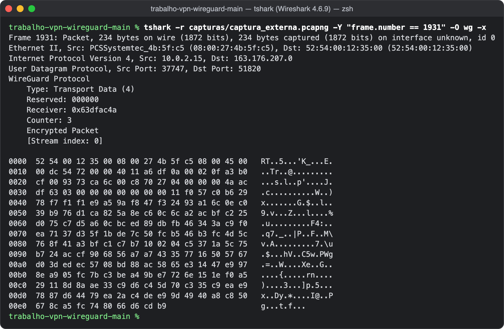

<sub>**Figura 17.** Dissecação do pacote 1931 (`-O wg -x`): um único cabeçalho IPv4 (o externo), UDP, os campos `Type`, `Receiver` e `Counter` e o `Encrypted Packet` ilegível no *dump* hexadecimal.</sub>

| Função | IPsec ESP em modo túnel | WireGuard (observado nas capturas) |
|---|---|---|
| Cabeçalho externo | IP novo com os endereços dos *gateways* | IP + UDP novos: `10.0.2.15:37747` → `163.176.207.0:51820` |
| Identificador da associação | SPI de 32 bits, escolhido pelo **receptor** | `receiver` de 32 bits, escolhido pelo **receptor**: a Matriz escolheu `0x63DFAC4A` (pacote 1920) e a Filial escolheu `0xCB45EF57` (pacote 1919) |
| Associação por sentido | Duas SAs unidirecionais, cada uma com o seu SPI | Cada sentido tem o seu índice e o seu contador: Filial→Matriz usa `receiver=0x63DFAC4A`; Matriz→Filial usa `receiver=0xCB45EF57` |
| Anti-replay | *Sequence Number* + janela deslizante | `counter` de 64 bits + janela deslizante (também é o *nonce* da cifra) |
| Carga | Datagrama original inteiro, cifrado | Datagrama original inteiro, cifrado (`Encrypted Packet`) |
| Preenchimento | *Padding* + *Pad Length* + *Next Header* (trailer ESP) | *Padding* até múltiplo de 16 bytes (154 → 160) |
| Integridade | ICV | Tag Poly1305 de 16 bytes |
| Estabelecimento de chaves | IKEv2 | Handshake Noise (`Handshake Initiation` 190 bytes / `Handshake Response` 134 bytes) |
| Renovação de chaves | *Rekey* de CHILD_SA conforme o tempo de vida configurado | Novo handshake a cada 2 min: pacotes 1919/1920 e 3052/3053, 130,9 s de intervalo, cada um com novos índices |

A coincidência entre o `receiver` do WireGuard e o SPI do ESP aparece claramente na captura (Figura 18): os pacotes enviados pela Filial carregam o índice que a **Matriz** escolheu na *Handshake Response* (`sender=0x63DFAC4A`), e os pacotes enviados pela Matriz carregam o índice que a **Filial** escolheu na *Handshake Initiation* (`sender=0xCB45EF57`). No IPsec é igual: o SPI de uma SA de entrada é escolhido por quem vai recebê-la, para que o receptor localize rapidamente a chave que deve usar.

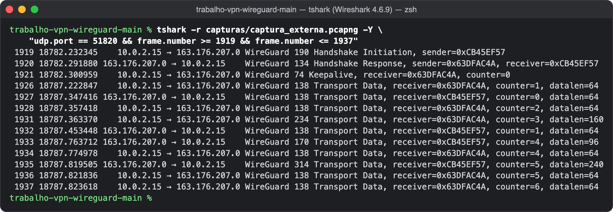

<sub>**Figura 18.** Handshake e dados da sessão: cada lado escolhe o índice que vai receber (`sender` na Initiation/Response) e o outro lado o usa como `receiver`, como o SPI do ESP; cada sentido tem o seu próprio `counter`.</sub>

### b) Semelhanças e diferenças em relação ao IPsec

#### Semelhanças

- **Camada e modelo:** ambos atuam na camada 3 e encapsulam datagramas IP completos, de forma transparente para as aplicações. O `curl` não precisou de nenhuma configuração para usar a VPN.
- **Serviços de segurança:** confidencialidade, integridade, autenticação da origem dos dados e proteção contra *replay*, por pacote.
- **Cifra autenticada (AEAD):** o ESP moderno usa AES-GCM ou o mesmo **ChaCha20-Poly1305** do WireGuard, padronizado para IPsec na RFC 7634.
- **Separação entre controle e dados:** no IPsec, o IKE negocia as chaves e o ESP transporta os dados. No WireGuard, o handshake Noise faz o primeiro papel e as mensagens `Transport Data` fazem o segundo.
- **Sigilo futuro (*forward secrecy*):** as chaves de sessão vêm de trocas Diffie-Hellman efêmeras e são renovadas periodicamente.
- **Política de tráfego:** a SPD do IPsec (*traffic selectors*) define o que entra no túnel. No WireGuard, esse papel é do `AllowedIPs = 10.10.10.0/24` (*cryptokey routing*, Questão 2).
- **Overhead parecido:** para o mesmo `GET` de 154 bytes, um ESP em modo túnel com AES-GCM (IV de 8 bytes e ICV de 16) e NAT-T geraria um quadro de cerca de 230 bytes (14 Eth + 20 IP + 8 UDP + 8 SPI/Seq + 8 IV + 156 cifrados + 16 ICV). O WireGuard gerou 234 bytes. Esse valor do ESP é uma estimativa teórica, não foi medido.

#### Diferenças

| Aspecto | IPsec (ESP em modo túnel + IKEv2) | WireGuard |
|---|---|---|
| Negociação de algoritmos | Sim: propostas IKE para cifra, integridade, PRF e grupo DH | Não: conjunto fixo, sem *downgrade* possível (Questão 1b) |
| Autenticação dos pares | PSK, certificados X.509/PKI ou EAP | Somente chaves públicas Curve25519 trocadas manualmente (+ PSK opcional) |
| Protocolos e modos | AH e ESP, em modo transporte ou túnel | Um único formato, sempre equivalente a "túnel" |
| Proteção só de integridade | Possível (AH, ou ESP com cifra `NULL`) | Impossível: todo pacote é cifrado |
| Transporte | ESP é o protocolo IP 50; UDP 4500 só quando há NAT (NAT-T) | Sempre UDP (51820 no laboratório) |
| Travessia de NAT | NAT-T, detectado durante o IKE | Nativa; o `PersistentKeepalive` mantém o mapeamento (Questão 1c) |
| Resposta a pacotes não autenticados | O IKE responde a qualquer `IKE_SA_INIT` | Silencioso: antes do cadastro da chave, a Matriz não respondia nada (`0 B received`, Questão 1a) |
| Estado e configuração | SPD + SAD, tempos de vida, propostas, seletores | Interface comum (`wg0`) + lista de *peers* com `AllowedIPs` |
| Mobilidade | Endereço do par fixo na SA (exige MOBIKE) | *Roaming*: o *endpoint* é atualizado ao receber um pacote autenticado de um endereço novo |
| Endereçamento | O IKEv2 pode atribuir o IP do túnel (*Configuration Payload*) | IP estático no `Address` (`10.10.10.13`, Questão 2) |
| Renovação de chaves | Tempos de vida configuráveis (por tempo ou volume) | Fixa: a cada 2 minutos ou após 2^60 mensagens |
| Complexidade | Centenas de milhares de linhas (*daemon* IKE + kernel) | ~4 mil linhas |
| Padronização | IETF (RFC 4301, 4303, 7296), aceito em normas como FIPS 140 | Não é padrão IETF; ChaCha20 não é aprovado pelo FIPS |

**Síntese.** O WireGuard implementa a mesma ideia do ESP em modo túnel: um IP externo entre os *gateways*, o datagrama original inteiro cifrado e autenticado, um identificador de sessão escolhido pelo receptor e um contador contra *replay*. A diferença está no plano de controle. O IPsec é flexível e negociável, o que o torna adequado a ambientes heterogêneos e regulados, mas também complexo e sujeito a erros de configuração. O WireGuard troca essa flexibilidade por um projeto fixo, pequeno e auditável, mais simples de configurar, como mostraram as poucas linhas do `wg0.conf` usado no laboratório.

## Questão 7 – HTTP puro dentro da VPN

A VPN implementada é *Gateway-to-Gateway*: a proteção começa quando o pacote entra na `wg0` do Gateway da Filial e termina quando sai da `wg0` da Matriz. Fora desse trecho, a requisição é HTTP comum, sem cifra e sem integridade.

```
Cliente ──── HTTP em claro ────> Gateway Filial ════ túnel WireGuard (cifrado) ════> Matriz ──> serviço HTTP :8080
192.168.100.2     rede_filial     eth1 │ wg0                Internet                wg0 10.10.10.1
```

### a) Um invasor na rede interna da Filial conseguiria ler os dados confidenciais?

**Sim.** A captura interna (Ponto A) mostra exatamente o que um invasor na `rede_filial` veria. Com *Seguir Fluxo TCP*, aparecem em texto claro o recurso pedido, os cabeçalhos e o **conteúdo integral do arquivo**, `Relatorio financeiro Q4 - CONFIDENCIAL` (Questão 3) (Figura 14).

Nem é preciso remontar o fluxo. Um filtro por `http.request` já mostra a URL pedida, e uma busca pela palavra `CONFIDENCIAL` encontra o pacote 585, com o conteúdo do arquivo legível no próprio *dump* hexadecimal (Figura 19). É o mesmo que um *sniffer* faria automaticamente, procurando palavras como "senha" ou "confidencial" no tráfego da rede.

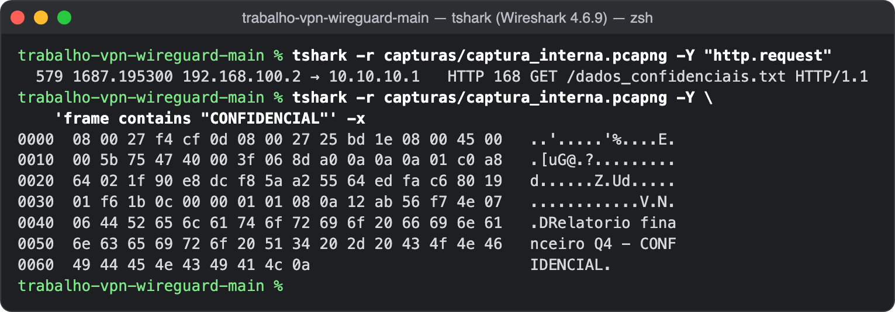

<sub>**Figura 19.** Captura interna: o filtro `http.request` mostra a URL pedida, e a busca por `CONFIDENCIAL` encontra o pacote 585 com o conteúdo do arquivo legível no *dump*.</sub>

Formas de o invasor obter esse tráfego:

- **Escuta passiva:** uma máquina comprometida no mesmo segmento, em modo promíscuo, com espelhamento de porta no *switch* ou em um *hub*. Foi o que a gravação do VirtualBox fez na placa do Cliente.
- **Homem no meio (*ARP spoofing*):** o invasor anuncia o próprio MAC como sendo o do Gateway (`192.168.100.1`). O Cliente passa a lhe entregar os pacotes, e ele os repassa ao Gateway verdadeiro depois de lê-los.
- **Comprometimento do próprio Gateway:** antes de cifrar, o Gateway manipula o pacote em claro. Um `tcpdump -i eth1` ou `tcpdump -i wg0` nele mostra o HTTP inteiro.

O risco vai além da leitura:

- **Adulteração:** o HTTP não tem integridade criptográfica, e o *checksum* do TCP não impede alteração intencional. Um invasor em posição de homem no meio pode modificar a requisição ou o arquivo devolvido sem que o Cliente perceba.
- **Acesso direto, sem nem precisar escutar:** o Gateway encaminha para o túnel qualquer pacote que chegue pela `eth1` (`FORWARD -i eth1 -o wg0 -j ACCEPT` + `MASQUERADE`, Questão 2), e a Matriz enxerga toda a Filial como um único endereço, `10.10.10.13`. A VPN autentica o **Gateway**, não o usuário nem a máquina. Como o servidor (`SimpleHTTP`) não pede nenhuma credencial, qualquer máquina da Filial pode executar o mesmo `curl` e baixar o arquivo.

### b) O mesmo cenário se repete na rede interna da Matriz?

**Em princípio, sim.** A situação é simétrica: o Gateway da Matriz decifra o pacote, e daí até o servidor final a requisição volta a ser HTTP em claro. Numa Matriz típica, com o *gateway* VPN separado do servidor de arquivos, um invasor na rede interna da Matriz leria o `GET` e o arquivo da mesma forma que na Filial.

**No laboratório, porém, o trecho em claro na Matriz é bem menor.** Os dados indicam que o serviço HTTP roda **na mesma máquina que termina o túnel** (TTL e MSS de cada pacote no (Figura 20):

1. O endereço do servidor, `10.10.10.1`, é o próprio endereço da `wg0` da Matriz (topologia do roteiro).
2. No `SYN, ACK` (pacote 577 da captura interna), o servidor anuncia **`MSS=1380`**, enquanto o Cliente anuncia `MSS=1460` (Figura 13). O MSS é calculado a partir do MTU da interface de saída: 1380 = 1420 − 20 (IP) − 20 (TCP), e 1420 é o MTU de uma interface WireGuard (Questão 1). Um servidor ligado a uma LAN Ethernet atrás de um *gateway* anunciaria 1460, como o Cliente.
3. Os segmentos TCP do servidor chegam ao Cliente com **TTL 63**. Isso é compatível com o valor inicial padrão do Linux (64) decrementado uma única vez, no Gateway da Filial, ou seja, sem nenhum roteador entre o túnel e o servidor.

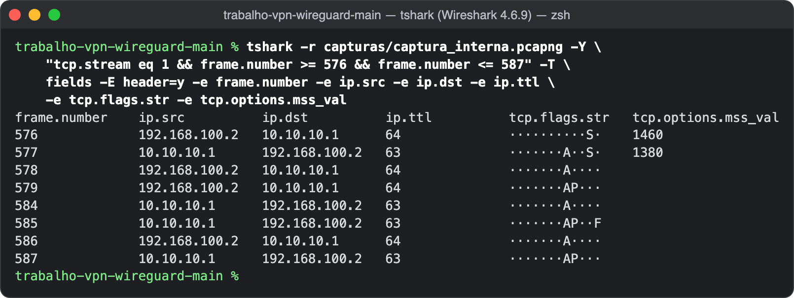

<sub>**Figura 20.** TTL e MSS por pacote na captura interna: o Cliente envia com TTL 64 e MSS 1460; o servidor responde com TTL 63 e MSS 1380 (MTU 1420 da `wg0` − 40).</sub>

Assim, depois de decifrado, o pacote vai da `wg0` direto para o processo Python dentro do mesmo kernel, sem passar por nenhuma rede física da Matriz. Isso **não elimina** o problema, apenas o desloca:

- quem tiver acesso administrativo ao servidor (ou um invasor que o comprometa) lê todo o tráfego em claro com `tcpdump -i wg0`, além dos *logs* do `SimpleHTTP`, que registram o caminho de cada requisição;
- o servidor é um *hub* compartilhado por todos os grupos (`10.10.10.0/24`, um *gateway* por grupo). As requisições de todas as filiais são decifradas nesse único ponto, e, sem controle de acesso na aplicação, qualquer filial conectada à VPN pode baixar o mesmo arquivo.

### c) Seria possível proteger toda a comunicação? Como?

**Sim, combinando a VPN com segurança na camada de aplicação: HTTPS (HTTP sobre TLS 1.3) por dentro do túnel.** É a defesa em profundidade: cada camada cobre o que a outra não cobre.

| | Só VPN (o que foi feito) | VPN + HTTPS |
|---|---|---|
| Rede interna da Filial | HTTP em claro | Apenas registros TLS cifrados |
| Internet (entre os *gateways*) | Cifrado pelo WireGuard | Cifrado duas vezes (TLS dentro do WireGuard) |
| Dentro do servidor da Matriz / LAN da Matriz | HTTP em claro | Cifrado até o processo do servidor |
| Autenticação do servidor | Nenhuma | Certificado verificado pelo `curl` |
| Metadados internos (IPs e portas originais) na Internet | Ocultos | Ocultos |

O TLS cifra **de ponta a ponta**, do processo `curl` ao processo do servidor. Com isso:

- **Confidencialidade e integridade** em todos os trechos: cada registro TLS é protegido por AEAD (AES-GCM ou ChaCha20-Poly1305), e qualquer alteração derruba a conexão.
- **Autenticação do servidor:** o servidor apresentaria um certificado emitido por uma CA interna da empresa, com `IP:10.10.10.1` ou um nome interno no SAN. O `curl` verificaria esse certificado (`curl --cacert ca-matriz.crt https://10.10.10.1:8443/dados_confidenciais.txt`). Assim, o *ARP spoofing* do item (a) só permitiria ao invasor bloquear a conexão, nunca lê-la ou se passar pelo servidor.
- **Na captura interna**, o *Seguir Fluxo TCP* passaria a mostrar só o *handshake* TLS e registros `Application Data` ilegíveis. No TLS 1.3, até o certificado do servidor vai cifrado.

Como a VPN autentica apenas os *gateways*, é preciso também **controlar o acesso** por usuário ou por máquina:

- **autenticação do cliente na aplicação**, seja por TLS mútuo (certificado do cliente, mTLS) ou por login/token transmitido dentro do HTTPS, para que só usuários autorizados baixem o arquivo;
- **firewall restritivo no Gateway**, continuando a sugestão da Questão 2: política `-P FORWARD DROP` e liberar só o necessário, por exemplo `iptables -A FORWARD -i eth1 -o wg0 -s 192.168.100.2 -d 10.10.10.1 -p tcp --dport 8443 -j ACCEPT`, mais a regra de estado `ESTABLISHED,RELATED` para o retorno.

Medidas complementares, que reduzem o risco mas **não substituem** o TLS de ponta a ponta:

- **VPN *client-to-site*:** o WireGuard roda no próprio Cliente, e não só no Gateway, eliminando o trecho em claro na Filial;
- **proteção da LAN:** segmentação em VLANs, 802.1X para impedir máquinas não autorizadas, *Dynamic ARP Inspection* contra *ARP spoofing* e MACsec (802.1AE) para cifrar os enlaces locais;
- **cifragem do próprio arquivo** (em repouso), que protege o conteúdo até no disco do servidor.

**Conclusão.** A VPN protege o trecho público entre as unidades e esconde quem conversa com quem dentro delas, mas não protege as redes internas nem diferencia usuários. O HTTPS protege o conteúdo de ponta a ponta e autentica o servidor, mas, sozinho, exigiria publicar o serviço na Internet e deixaria visíveis os endereços e portas das máquinas que conversam. As duas camadas juntas, somadas ao controle de acesso, protegem toda a comunicação, seguindo o princípio de não confiar na rede interna só por ela ser "interna".

## Questão 8 – O que um atacante entre os gateways consegue descobrir

Um atacante posicionado entre o Gateway da Filial e a Matriz (provedor de Internet, roteador comprometido, Wi-Fi do laboratório) enxerga exatamente o que está na **captura externa** (Ponto B) (Figura 6). A análise abaixo usa os pacotes WireGuard dessa captura (filtro `udp.port == 51820`, 33 pacotes).

### O que o atacante consegue descobrir (metadados)

| Informação | Valor observado no laboratório | Onde aparece |
|---|---|---|
| Endereços dos extremos do túnel | `10.0.2.15` ↔ `163.176.207.0`. Na Internet, no lugar de `10.0.2.15` aparece o IP público da rede do hospedeiro, já traduzido pelo NAT | Cabeçalho IP externo |
| Protocolo de transporte e portas | UDP, `37747` → `51820` | Cabeçalho UDP |
| Que se trata de uma VPN WireGuard | O Wireshark identifica `WireGuard Protocol` sem nenhuma chave | Porta padrão, campo `tipo` (1 a 4) seguido de 3 bytes zerados e tamanhos fixos: 148 bytes de carga UDP na *Initiation*, 92 na *Response* e 32 no *Keepalive* |
| Tipo de cada mensagem | `Handshake Initiation`, `Handshake Response`, `Transport Data`, `Keepalive` | Cabeçalho WireGuard (não cifrado) |
| Identificadores de sessão | `0x58C03126` → `0x63DFAC4A` → `0x61169196` (sentido Filial→Matriz) | Campo `receiver`: permite agrupar os pacotes de cada sessão e ver quando as chaves são renovadas |
| Quantidade de pacotes da sessão | `counter` de 0 a 12 na sessão `0x63DFAC4A` | Campo `counter`. O salto de 1 para 4 nos pacotes da Matriz (1932 → 1933) revela até perdas de pacotes |
| Tamanho de cada pacote | 74, 138, 170, 234 e 314 bytes | O tamanho original fica exposto com margem de 15 bytes (o *padding* só arredonda para múltiplo de 16) |
| Momento e ritmo do tráfego | Rajada de 11 pacotes entre 18787,2 s e 18787,9 s; *keepalives* a cada ~23 s; handshakes em 1919 e 3052 | *Timestamps* |
| Chaves públicas efêmeras do handshake | 32 bytes em claro, por exemplo `5l1yokRh…` no pacote 1919 | Campo `Ephemeral`. Não é segredo: sem a parte privada correspondente, não ajuda o atacante |
| Identidade dos dois lados, se ele tiver chaves públicas candidatas | Initiation 1919 → Matriz (`f/iC7Qjn…`); Response 1920 → Gateway da Filial (`vFILIz…`) | Campo `mac1`, calculado com a chave pública **do destinatário** de cada mensagem |

**O que o handshake expõe.** Na *Handshake Initiation* (pacote 1919), o Wireshark mostra a chave efêmera em claro (`Ephemeral`). A chave estática do iniciador e o *timestamp* aparecem só como blocos opacos (`Encrypted Static`, `Encrypted Timestamp`), e o `mac2` está zerado (Figura 21).

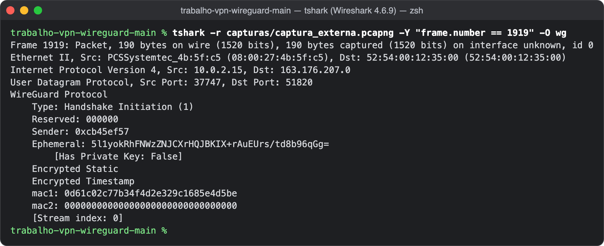

<sub>**Figura 21.** *Handshake Initiation* (pacote 1919): chave efêmera em claro, chave estática e *timestamp* apenas cifrados, `mac2` zerado.</sub>

**Identificação dos *peers* pelo `mac1`.** As chaves públicas não são segredo: a da Matriz está no `wg0.conf` de todos os grupos, e a do Gateway foi enviada ao professor e aparece no `wg show`. Para testar o que um atacante com essas chaves consegue, foram configuradas no Wireshark **apenas as duas chaves públicas**, sem nenhuma chave privada (opção `wg_keys`). O Wireshark verificou o `mac1` de cada mensagem e identificou o destinatário de ambas: a Initiation 1919 foi para a Matriz e a Response 1920 foi para o Gateway da Filial (Figura 22). Ou seja, quem tiver uma lista de chaves públicas candidatas, como as de todos os grupos, descobre **qual Filial** iniciou cada sessão, mesmo com a chave estática cifrada. A proteção de identidade do WireGuard vale contra quem não conhece as chaves públicas, não contra quem já tem uma lista delas. O conteúdo da sessão continua inacessível, porque o `mac1` não ajuda a derivar as chaves de sessão.

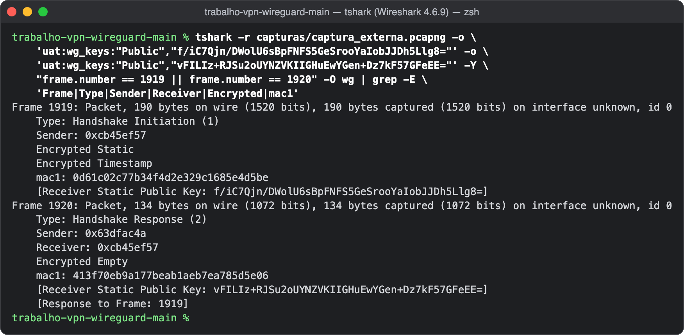

<sub>**Figura 22.** Com apenas as chaves **públicas** da Matriz e do Gateway configuradas (sem chaves privadas), o Wireshark verifica o `mac1` e identifica o destinatário de cada mensagem do handshake.</sub>

**Análise de tráfego.** Mesmo sem decifrar nada, a sequência de tamanhos e tempos permite inferências razoáveis. Com a coluna de tempo mostrando o intervalo desde o pacote anterior (`-t dd`), os padrões ficam evidentes (Figura 23):

- **Pacotes 1241 a 1916:** oito pacotes de 138 bytes, sem resposta, com intervalos de ~1 s e depois 2 s e 4 s. É o padrão de *backoff* de retransmissão do TCP, sugerindo uma tentativa de conexão que não está sendo respondida.
- **Pacotes 1926 a 1945:** três pacotes de 138 bytes em ida e volta (cara de *three-way handshake*), um pedido de ~150 bytes (234) e uma resposta pequena (170 + 314), seguidos de encerramento. É o perfil de uma requisição curta a um arquivo pequeno, compatível com um download HTTP.
- ***Keepalives* de 74 bytes a cada ~23–25 s:** revelam que o túnel está ativo mesmo sem uso, que o lado da Filial usa `PersistentKeepalive = 25` e, portanto, que provavelmente está atrás de NAT.

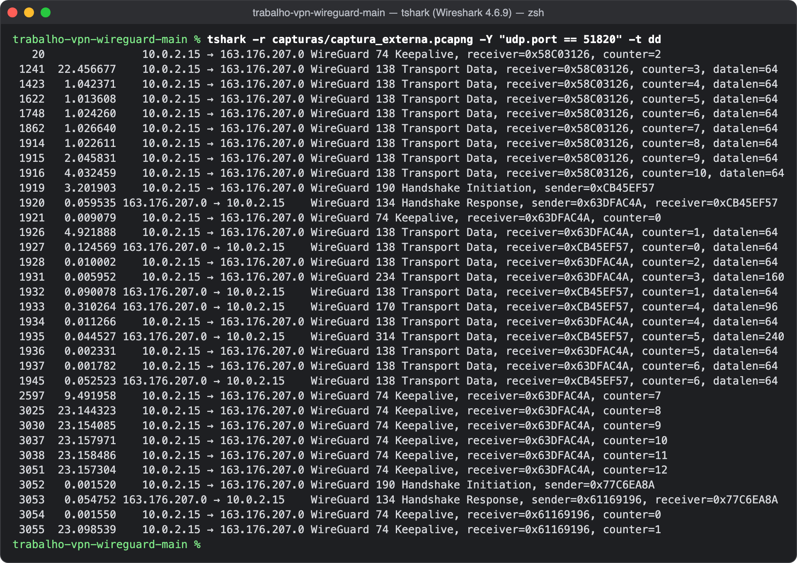

<sub>**Figura 23.** Tráfego WireGuard com o intervalo desde o pacote anterior (`-t dd`): retransmissões a cada 1, 2 e 4 s, rajada do `curl`, *keepalives* a cada ~23 s e renovação de chaves.</sub>

Ou seja, o atacante sabe **que** a Filial conversa com a Matriz, **quando**, **quanto** e com que ritmo. Isso basta para mapear a relação entre as unidades e os horários de uso, mas não para saber **quem**, dentro das redes, conversa, nem **sobre o quê**.

### O que permanece protegido contra leitura

| Dado | Valor real (conhecido só pelas capturas internas) |
|---|---|
| Endereços IP originais | `192.168.100.2` (Cliente), `10.10.10.13` (após o `MASQUERADE`) e `10.10.10.1` (servidor) |
| Protocolo e portas internos | TCP, `59612` → `8080`. Nem o fato de ser TCP é visível |
| Controle do TCP | *Flags*, números de sequência e opções (como o `MSS=1380`) |
| Requisição HTTP | `GET /dados_confidenciais.txt`, `Host: 10.10.10.1:8080`, `User-Agent: curl/8.22.0` |
| Resposta HTTP | `200 OK`, `Server: SimpleHTTP/0.6 Python/3.9.25`, datas e tamanho |
| Conteúdo do arquivo | `Relatorio financeiro Q4 - CONFIDENCIAL` |
| Tamanho exato do pacote original | Só aproximado, por causa do *padding* |
| Identidade do iniciador (proteção parcial) | A chave pública estática da Filial vai **cifrada** na *Handshake Initiation* (`Encrypted Static`, 48 bytes) e não pode ser lida. Quem já tem chaves públicas candidatas, porém, confirma a identidade pelo `mac1` da *Response*, como mostrado acima |
| *Timestamp* do handshake | Cifrado (`encrypted_timestamp`, 28 bytes) |
| Chaves | As chaves privadas nunca trafegam, e as chaves de sessão são derivadas localmente por Diffie-Hellman |

Na prática, buscar as palavras `CONFIDENCIAL`, `dados_confidenciais` ou `curl` em todos os bytes da captura externa retorna **0 pacotes**. Na captura interna, a mesma busca retorna 2 (o `GET` e o corpo do arquivo). O filtro pelos endereços internos (`192.168.100.2`, `10.10.10.1` e `10.10.10.13`) também retorna **0 pacotes** na captura externa (Figura 24). O pacote que leva o `GET` só mostra o bloco cifrado (Figura 15).

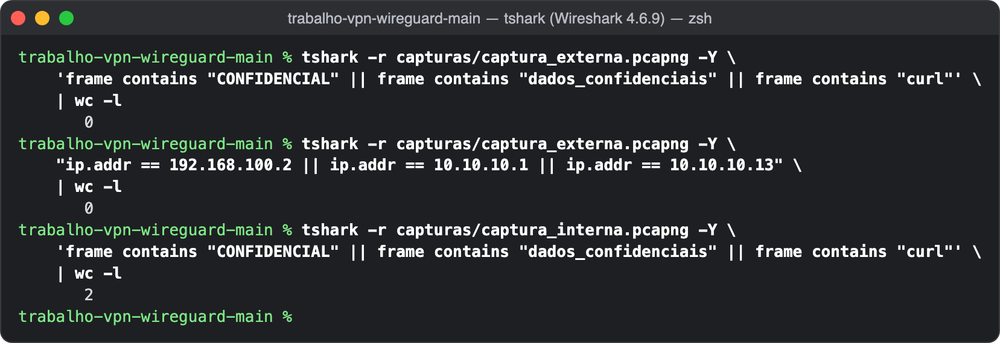

<sub>**Figura 24.** Busca por conteúdo e endereços internos: 0 pacotes na captura externa e 2 pacotes na interna.</sub>

### O que permanece protegido contra adulteração

- **Integridade de cada pacote:** toda mensagem `Transport Data` termina com a tag Poly1305 de 16 bytes. Se um único bit da carga cifrada for alterado, a verificação falha no receptor e o pacote é **descartado em silêncio**, sem nunca chegar ao Cliente ou ao servidor. O `counter` é o *nonce* da cifra, então alterá-lo também invalida a verificação; alterar o `receiver` faz o receptor usar uma chave errada, com o mesmo resultado.
- **Injeção de pacotes:** forjar um pacote válido exige a chave de sessão, e concluir um handshake exige a chave privada estática de um dos lados (autenticação mútua, Questão 1a).
- ***Replay*:** reenviar um pacote capturado (por exemplo, repetir o `GET` do pacote 1931) não funciona, pois o contador já foi usado e a janela deslizante o rejeita. Uma *Handshake Initiation* repetida também é rejeitada, porque o seu *timestamp* cifrado precisa ser maior que o último aceito daquele *peer*.
- **Sigilo futuro (*forward secrecy*):** as chaves de sessão vêm de trocas Diffie-Hellman efêmeras e são substituídas a cada 2 minutos. Na captura, os handshakes 1919 e 3052 criaram sessões novas, com índices novos. Mesmo que um atacante grave todo o tráfego hoje e, no futuro, roube a chave privada do Gateway (`/etc/wireguard/priv`), ele não consegue decifrar as sessões passadas. Contra um eventual computador quântico que quebre o Curve25519, o WireGuard oferece a `PresharedKey` opcional (não usada no laboratório), que adiciona uma camada simétrica à derivação das chaves.

### O que a VPN não protege

- **Cabeçalhos externos:** o IP e o UDP externos não são autenticados pelo WireGuard, assim como no ESP. Alterá-los só desvia ou descarta pacotes; não dá acesso ao conteúdo.
- **Disponibilidade:** o atacante no caminho pode descartar, atrasar ou bloquear o UDP 51820 e derrubar o túnel. O WireGuard só se protege contra a sobrecarga de processamento: sob carga, o respondedor passa a exigir um *cookie* (campo `mac2`). Na captura, `mac2` está zerado, ou seja, a Matriz não estava sob carga.
- **Metadados e análise de tráfego:** tudo o que foi listado na primeira tabela.

### Resumo

| O atacante descobre | Fica protegido contra leitura e adulteração |
|---|---|
| IPs públicos dos dois *gateways* e a porta UDP 51820 | IPs e portas originais do Cliente e do servidor |
| Que é uma VPN WireGuard e o tipo de cada mensagem | Protocolo interno (TCP) e todo o conteúdo HTTP |
| Quais *peers* fizeram o handshake, se tiver as chaves públicas candidatas (`mac1`) | Chaves privadas e chaves de sessão |
| Quando há sessão, handshake e renovação de chaves | URL, cabeçalhos e o arquivo confidencial |
| Quantidade, tamanho aproximado e horário dos pacotes | Integridade de cada pacote (Poly1305), com descarte se alterado |
| Ritmo do *keepalive* (túnel ativo, Filial atrás de NAT) | Proteção contra *replay* (contador) e sigilo futuro (chaves efêmeras) |

## Conclusão

O experimento mostrou na prática o funcionamento e os limites de uma VPN de camada 3:

- **Estabelecimento do túnel:** o WireGuard autentica os dois lados com pares de chaves Curve25519 e conclui o handshake em uma única ida e volta (190 + 134 bytes). Enquanto a chave do grupo não estava cadastrada, a Matriz simplesmente não respondia. Os *keepalives* de 74 bytes, a cada ~25 s (~23 s medidos), mantêm o mapeamento do NAT, e um novo handshake renova as chaves a cada 2 minutos (Questão 1).
- **Tunelamento:** na rede interna, a requisição HTTP é legível por completo, inclusive o conteúdo do arquivo confidencial (Questão 3). Na saída externa, ela vira um datagrama UDP 51820 entre os dois *gateways*, sem nenhum vestígio da URL, dos cabeçalhos ou dos endereços originais (Questão 4).
- **Overhead:** cada pacote ganha 60 bytes fixos (IP + UDP + cabeçalho WireGuard + tag Poly1305) e até 15 bytes de *padding*. O `GET` passou de 168 para 234 bytes. Por isso a `wg0` usa MTU 1420 e o servidor anuncia MSS 1380. Na rede externa existem dois cabeçalhos IP, mas só o externo é visível (Questão 5).
- **Relação com o IPsec:** o comportamento observado equivale ao ESP em modo túnel (com NAT-T): IP externo novo, datagrama original cifrado e autenticado, identificador de sessão escolhido pelo receptor (como o SPI) e contador contra *replay*. A diferença está no plano de controle: o WireGuard usa algoritmos fixos e configuração mínima, enquanto o IPsec negocia algoritmos e é mais flexível e mais complexo (Questão 6).
- **Limites da VPN:** a proteção vale apenas entre os *gateways*. Com HTTP puro, um invasor na rede interna da Filial (ou com acesso ao servidor da Matriz) lê e pode alterar os dados, e a VPN não distingue usuários. A solução é a defesa em profundidade: HTTPS/TLS de ponta a ponta dentro da VPN, autenticação do cliente na aplicação e regras de firewall restritivas (Questão 7).
- **Visão do atacante externo:** quem intercepta o tráfego entre as unidades descobre apenas metadados: IPs públicos, porta, tipo de mensagem, tamanhos e horários e, se já tiver as chaves públicas candidatas, até qual Filial iniciou a sessão (pelo `mac1`). O conteúdo, os endereços internos e a integridade dos pacotes ficam protegidos, com proteção contra *replay* e sigilo futuro (Questão 8).

As capturas também registraram dois eventos não planejados que ilustram a robustez do conjunto. O primeiro foi a renegociação automática da sessão depois de 15 s sem resposta da Matriz, que explica as retransmissões do `SYN` (Questão 4). O segundo foi a perda de dois pacotes da resposta dentro do túnel, revelada pelo salto do contador WireGuard e recuperada pelo TCP com SACK (Questão 3).

## Arquivos entregues e filtros utilizados

| Arquivo | Conteúdo |
|---|---|
| `capturas/captura_interna.pcapng` | Ponto A: placa do Cliente na `rede_filial` (820 pacotes) |
| `capturas/captura_externa.pcapng` | Ponto B: placa `eth0` do Gateway (3057 pacotes, 33 do WireGuard) |
| `capturas/captura_keepalive_25s.pcapng` e `captura_keepalive_5s.pcapng` | Experimento do `PersistentKeepalive` (Questão 1c) |
| `config/wg0.conf` | Configuração usada no Gateway, sem a chave privada |
| `config/comandos_executados.md` | Comandos executados nas VMs e no VirtualBox |
| `prints/` | Capturas de tela citadas neste relatório |

| Filtro do Wireshark | Captura | Uso |
|---|---|---|
| `tcp.stream eq 1` (ou `tcp.port == 8080`) | Interna | Pacotes da requisição do `curl` (Questões 3 e 5) |
| `udp.port == 51820` | Externa | Todo o tráfego WireGuard (Questões 4, 5 e 8) |
| `udp.port == 51820 && frame.len > 74` | Externa | Esconde os *keepalives* e deixa só handshakes e dados (Questão 5) |
| `ip.addr == 192.168.100.2 \|\| ip.addr == 10.10.10.1` | Externa | Nenhum resultado: os IPs originais não aparecem (Questões 4 e 8) |

## Referências

- DONENFELD, J. A. *WireGuard: Next Generation Kernel Network Tunnel*. In: Network and Distributed System Security Symposium (NDSS), 2017. Disponível em: <https://www.wireguard.com/papers/wireguard.pdf>.
- WIREGUARD. *Protocol & Cryptography*. Disponível em: <https://www.wireguard.com/protocol/>.
- PERRIN, T. *The Noise Protocol Framework*, rev. 34, 2018. Disponível em: <https://noiseprotocol.org/noise.html>.
- KENT, S.; SEO, K. *RFC 4301: Security Architecture for the Internet Protocol*. IETF, 2005.
- KENT, S. *RFC 4302: IP Authentication Header*. IETF, 2005.
- KENT, S. *RFC 4303: IP Encapsulating Security Payload (ESP)*. IETF, 2005.
- HUTTUNEN, A. et al. *RFC 3948: UDP Encapsulation of IPsec ESP Packets*. IETF, 2005.
- KAUFMAN, C. et al. *RFC 7296: Internet Key Exchange Protocol Version 2 (IKEv2)*. IETF, 2014.
- NIR, Y. *RFC 7634: ChaCha20, Poly1305, and Their Use in the Internet Key Exchange Protocol (IKE) and IPsec*. IETF, 2015.
- RESCORLA, E. *RFC 8446: The Transport Layer Security (TLS) Protocol Version 1.3*. IETF, 2018.
- STALLINGS, W. *Criptografia e Segurança de Redes: Princípios e Práticas*. 6. ed. São Paulo: Pearson, 2015.
- KUROSE, J. F.; ROSS, K. W. *Redes de Computadores e a Internet: uma abordagem top-down*. 8. ed. São Paulo: Pearson, 2021.
